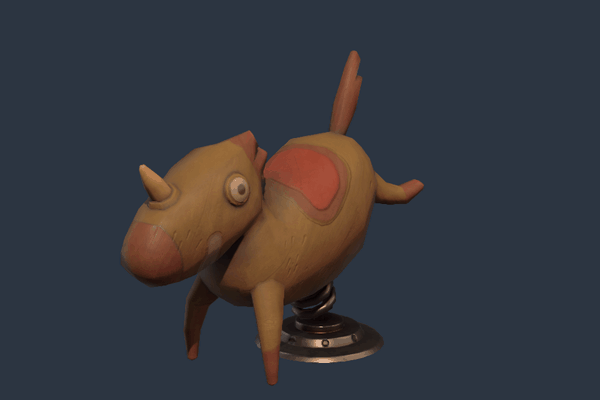

# filly

filly renders glTF 3D models with [Google Filament](https://github.com/google/filament), for
programs that own their window and their frame timing. It loads a model, lights it, poses it,
and renders it into an image in memory or into an OpenGL texture that your program draws.

One C++ renderer has three frontends:

- **Python:** PsychoPy, pyglet, moderngl, zengl, or offscreen with NumPy images.
- **MATLAB and Octave:** Psychtoolbox windows, or offscreen.
- **Browsers:** WebAssembly for WebGL2, for example in PsychoJS experiments.

The frontends have the same objects, names (in each language's style), and behavior.



*"[Wooden Playground Horse](https://sketchfab.com/3d-models/wooden-playground-horse-aa1c440f48a44e558dcc9097b35a6a6d)" by [Batuhan13](https://sketchfab.com/Batuhan13),
[CC BY 4.0](http://creativecommons.org/licenses/by/4.0/). See [attribution](examples/assets/ATTRIBUTION.md).*

## Install

| Frontend | Get it | Needs |
| --- | --- | --- |
| Python | `pip install filly` from [PyPI](https://pypi.org/project/filly/) | Python 3.10 or later |
| MATLAB and Octave | A package from the [releases](https://github.com/aforren1/filly/releases); see [install a release](docs/how-to/matlab.md#install-a-release) | MATLAB R2021b or later, or Octave 6.4 or later (Linux) |
| Web | [Build it](docs/how-to/build.md#build-for-the-web), then serve `filly.js`, `filly-core.js`, and `filly-core.wasm` | A browser with WebGL2 |

The desktop frontends need Windows or Linux on x86_64, or macOS 11 or later on Apple silicon
(arm64), and an OpenGL 4.1 driver. On Linux, offscreen rendering works without a display. On
macOS, filly cannot share textures with PsychoPy or Psychtoolbox windows. The PsychoPy adapter
copies each frame into the window instead, through an IOSurface on the GPU
([PsychoPy on macOS](docs/how-to/psychopy.md#use-psychopy-on-macos)); Psychtoolbox windows are
not supported. Imported host textures cannot be sampled as sRGB; see
[macOS limits](docs/how-to/build.md#run-on-macos). The
release packages for MATLAB and Octave are for Windows and Linux only. To build any frontend
from source, see [build and test](docs/how-to/build.md).

## Render an image

```python
import filly
from PIL import Image  # only to save the image

with filly.Renderer() as renderer:
    scene = renderer.create_scene()
    horse = scene.load(filly.samples.HORSE)  # a sample model installed with filly
    horse.apply_animation(0, 0.5)  # a pose from its gallop

    scene.camera = renderer.create_camera()
    scene.camera.frame(horse, direction=(-1, -0.3, -1))
    scene.add_directional_light(direction=(-1, -1, -2), intensity=100_000)

    target = renderer.create_render_target(width=800, height=600)
    renderer.render(scene, target)
    Image.fromarray(target.read()).save("horse.png")  # (600, 800, 4) uint8 RGBA
```

## Draw in a PsychoPy window

filly renders into a texture that PsychoPy draws directly, with no copy through the CPU. On
macOS, the GPU copies each frame into the window's context first.

```python
import filly
from psychopy import core, visual
from filly.integrations.psychopy import HostTarget, create_renderer

win = visual.Window((1024, 768), units="pix")
renderer = create_renderer(win)  # shares the window's OpenGL context
scene = renderer.create_scene()
horse = scene.load(filly.samples.HORSE)
scene.camera = renderer.create_camera()
scene.camera.frame(horse)
scene.add_directional_light(direction=(-1, -1, -2), intensity=100_000)

target = HostTarget(renderer, win, width=512, height=512)
stim = target.create_image_stim()
clock = core.Clock()
while clock.getTime() < 3:
    horse.apply_animation(0, clock.getTime())
    renderer.render(scene, target)
    stim.draw()
    win.flip()

renderer.close()
win.close()
```

Close the renderer before the window. The same pattern works with a
[pyglet, moderngl, or zengl window](docs/how-to/gl-hosts.md). For PsychoPy Builder components,
see [psychopy-filly](https://github.com/aforren1/psychopy-filly).

## Draw in a Psychtoolbox window

In MATLAB or Octave, filly renders into a texture that Psychtoolbox draws:

```matlab
win = Screen('OpenWindow', 0, 0);
r = filly.Renderer.forWindow(win);   % shares the window's OpenGL context
tgt = filly.PTBTarget(r, win);       % a Psychtoolbox texture that covers the window
scene = r.createScene();
horse = scene.load(filly.samples.horse());
scene.camera = r.createCamera();
scene.camera.frame(horse);
scene.addDirectionalLight([-1 -1 -2], 'Intensity', 100000);
start = GetSecs;
while ~KbCheck
    horse.applyAnimation(1, GetSecs - start);   % indices start at 1
    r.render(scene, tgt);
    tgt.draw();
    Screen('Flip', win);
end
close(r);   % before the window
sca;
```

See [use MATLAB, Octave, and Psychtoolbox](docs/how-to/matlab.md).

## Use it in a web page

The web build renders into a WebGL2 texture that your page draws with its own renderer, such as
PIXI in PsychoJS. See [use filly in a web page](docs/how-to/web.md).

## Features

- **glTF 2.0:** GLB and glTF files, skinning, morph targets, animation, material variants, and
  the common material extensions, such as clearcoat, sheen, transmission, and iridescence.
  Draco, meshopt, KTX2, and WebP compression. See
  [asset compatibility](docs/reference/api.md#asset-compatibility).
- **Cameras and lights:** perspective and orthographic cameras, camera framing, and directional,
  sun, point, and spot lights with optional shadows. Image-based lighting comes from an HDR
  panorama or prefiltered KTX files.
- **Stimuli from arrays:** textures and meshes from arrays, updated in place each frame, for
  gratings, noise, or deforming shapes.
- **Many objects per frame:** one call sets the transforms, material parameters, or morph
  weights of many nodes or materials. Copies of one generated mesh share its buffers, and
  Filament can draw up to 64 of them in one call.
- **Predictable output:** sRGB (default) or linear. Effects such as antialiasing, fog, and bloom
  are off until you enable them. With default settings, the same scene gives the same pixels on
  every frame.
- **Several views per frame:** each `render()` call can take its own camera and viewport, for
  example for side-by-side stereo.
- **Picking:** find the model, node, and world position under a pixel of a rendered frame, for
  example where a participant clicked. See [picking](docs/reference/api.md#picking).
- **No material compiler at run time:** filly ships its materials precompiled. See
  [material precompilation](docs/explanation/material-precompilation.md).

## Examples

Python examples are in `examples/python/`:

| Example | Shows |
| --- | --- |
| `screenshot.py` | The animation above (`--gif`), or a still image, rendered offscreen. |
| `psychopy_shared.py` | A model in a PsychoPy window with all the bells and whistles. Pass your own GLB path. |
| `psychopy_stress.py` | Repeated PsychoPy trials, with frame timing and memory reports. See [measure timing](docs/how-to/stress-test.md). |
| `pyglet_shared.py`, `moderngl_shared.py`, `zengl_shared.py` | The same (minus the bells and whistles) in other OpenGL hosts. |
| `drifting_grating.py` | A texture updated every frame on a tilted plane. |
| `stereo.py` | Two cameras side by side in one window. |
| `shapes.py` | Generated and deforming meshes. |
| `pick.py` | Click a model in a pyglet window: picking, with the hit node, point, and latency. `--auto` clicks by itself. |

MATLAB and Octave examples are in `examples/matlab/`:

| Example | Shows |
| --- | --- |
| `offscreen.m` | The sample horse rendered offscreen and saved as a PNG file. |
| `ptb_spin.m` | The sample horse galloping and turning in a Psychtoolbox window. |

## Documentation

- Tutorial: [render an image](docs/tutorials/offscreen.md)
- How-to guides: [build and test](docs/how-to/build.md),
  [use PsychoPy](docs/how-to/psychopy.md), [use other OpenGL hosts](docs/how-to/gl-hosts.md),
  [use MATLAB, Octave, and Psychtoolbox](docs/how-to/matlab.md),
  [use filly in a web page](docs/how-to/web.md),
  [measure timing](docs/how-to/stress-test.md), [profile a frame](docs/how-to/profile.md),
  [compare with Filament's viewer](docs/how-to/reference-comparison.md)
- Reference: [API](docs/reference/api.md), [performance](docs/reference/performance.md),
  [validation](docs/reference/validation.md), [sample assets](docs/reference/sample-assets.md),
  [upstream Filament issues](docs/reference/upstream-issues.md)
- Explanation: [design and limits](docs/explanation/design.md),
  [filly and Filament](docs/explanation/filament.md),
  [tested assumptions](docs/explanation/assumptions.md),
  [material precompilation](docs/explanation/material-precompilation.md),
  [the web build](docs/explanation/web.md),
  [macOS](docs/explanation/macos.md)

The source has one folder per part: `core/` (the shared renderer), `python/`, `matlab/`, and
`web/`. See [source layout](docs/how-to/build.md#source-layout).

## License

filly is released under the [MIT License](LICENSE).

It links [Filament](https://github.com/google/filament) (Apache 2.0),
[meshoptimizer](https://github.com/zeux/meshoptimizer) (MIT),
[libwebp](https://chromium.googlesource.com/webm/libwebp) (BSD), and
[cgltf](https://github.com/jkuhlmann/cgltf) (MIT). Each package installs their licenses.

The sample models are in the public domain (CC0 1.0). `filly.samples.HORSE` (Python) and
`filly.samples.horse()` (MATLAB and Octave) are "Horse" by Quaternius; see
[attribution](samples/ATTRIBUTION.md). `filly.samples.SUZANNE` (Python) is modified from Suzanne
by Norbert Nopper (UX3D), from the Khronos glTF Sample Assets.
